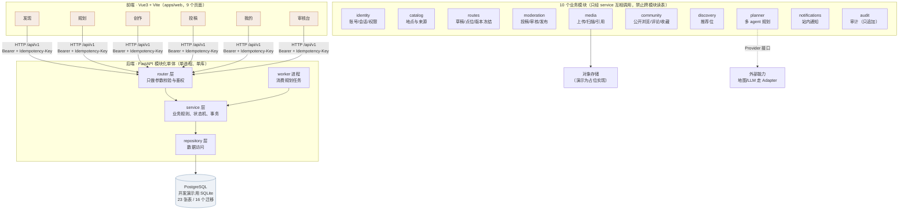
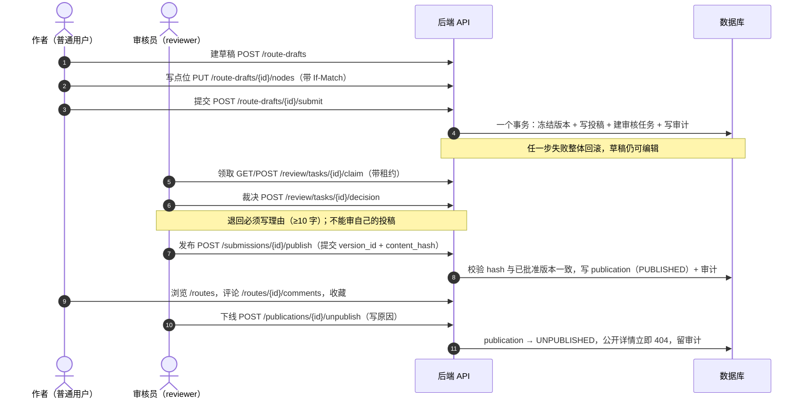

# 答辩材料（对外版）

> 用途：答辩现场讲、评委问细节时对照、以及给验收老师看"哪些做了、哪些没做"。
> 原则：**只写代码里真实存在的东西**。每条结论都能在仓库里指出具体文件或能当场跑出来。
> 更新日期：2026-11-03。

---

## 1. 一句话定位

**CulturalWalk（文化行走）**：把"按时间和预算挑几个长沙的点"变成"一条有顺序、有交通方式、有文化出处、还能被审核发布和被人收藏评论"的文化路线。

两个核心动作，同一个后端：

- **规划**：用户填条件 → 4 个 agent 协同排一条可执行行程 → 可一键转成自己的草稿
- **共创**：用户写路线 → 提交审核 → 审核员对着版本 hash 通过 → 发布 → 别人能看、能收藏、能评论

---

## 2. 系统架构（与 `services/api/app/modules/` 实际目录一一对应）



**为什么是单体不是微服务**：4 个人、17 周、单城试点。拆服务的运维成本远超收益，这条写在 ADR-0001 里；只有同时满足"单库写入成瓶颈 + 某模块要独立扩容 + 有人能长期运维"才拆。

---

## 3. 主链路（一条路线怎么从草稿变成线上内容）



**四个状态机互不复用**（`docs/02-数据模型与状态机.md`）：

| 对象 | 状态 |
|---|---|
| 路线草稿 | `EDITING → SUBMITTED_LOCKED → (退回)EDITING / (通过)APPROVED → PUBLISHED`，另有 `SUPERSEDED` |
| 投稿 | `PENDING_REVIEW → APPROVED / CHANGES_REQUESTED / REJECTED`，可 `RESUBMITTED` |
| 审核任务 | `OPEN → CLAIMED → COMPLETED / CANCELLED`（租约过期自动回 OPEN） |
| 发布记录 | `PUBLISHED → UNPUBLISHED` |

---

## 4. 模块职责与代码位置（评委会问"这块谁写的、在哪"）

| 模块 | 职责（一句话） | 代码位置 | 对外接口 |
|---|---|---|---|
| identity | 注册/登录/刷新/改密/个人主页 | `app/modules/identity/` | `/auth/*`、`/me`、`/users/{id}/profile` |
| catalog | 地点库与文化来源（含可信度） | `app/modules/catalog/` | `/places` |
| routes | 草稿、点位顺序、版本冻结 | `app/modules/routes/` | `/route-drafts/*`、`/routes/*` |
| moderation | 投稿、审核队列、裁决、发布/下线 | `app/modules/moderation/` | `/submissions/*`、`/review/tasks/*`、`/publications/*` |
| planner | 4 agent 编排、行程、估价、转草稿 | `app/modules/planner/` | `/plans/*` |
| community | 公开列表/详情/评论/收藏 | `app/modules/community/` | `/routes`、`/favorites`、`/comments` |
| discovery | 首页推荐位 | `app/modules/discovery/` | `/discovery/*` |
| media | 上传意图、隔离区→净化区、引用 | `app/modules/media/` | `/media/*` |
| notifications | 审核结果等站内通知 | `app/modules/notifications/` | `/notifications/*` |
| audit | 只追加审计（谁、什么时候、对哪个对象、哪个 hash） | `app/modules/audit/` | `/audit-logs` |

**协作硬规则**（写进 `docs/必读1-开发约定.md`，CI 与 code review 都在看）：router 只能调本模块 service；需要别的模块能力就调它的 service；**不许 import 别人的 models 直接读表**。

---

## 5. 分工与实际贡献（P1–P4）

| 角色 | 负责范围 | 已合入的活 |
|---|---|---|
| **P1**（架构/契约/QA） | 仓库骨架、CI、契约、迁移、审计、质量关卡、文档 | M0 全套、契约 37 路径 46 操作、迁移链、审计写入、前端测试补齐并进 CI、`scripts/preflight.sh`、`scripts/e2e_demo.py`、问题台账 |
| P2（后端·内容域） | identity / catalog / routes | 账号与会话、个人主页、地点库、草稿与点位、版本冻结、费用汇总 |
| P3（后端·流程域 + 数据） | moderation / planner / community / media | 投稿审核发布闭环、4 agent 规划与异步任务、公开浏览与评论收藏、媒体上传与删除 |
| P4（前端） | 9 个页面与交互 | 发现/规划/创作/投稿/我的/审核台/详情、真实接口对接、前端单测 128 例 |

> 分工表与 GitHub 上的 PR、任务卡（`tasks/cards.json` + Issues）是对齐的；谁做了哪张卡，看 issue 的 assignee 与合并记录。

---

## 6. 现场演示（6 分钟，命令都是真的）

**准备（演示前 10 分钟）**

```bat
:: 后端
cd services\api
.venv\Scripts\python.exe -m alembic upgrade head
.venv\Scripts\python.exe ..\..\scripts\seed_demo.py     :: 灌演示数据
.venv\Scripts\python.exe -m uvicorn app.main:app --port 8000

:: worker（另开窗口）
services\api\run_worker.bat

:: 前端（另开窗口）
pnpm -C apps\web dev      :: http://localhost:5173
```

**时间轴**

| 时间 | 动作 | 要讲的一句 |
|---|---|---|
| 0:00–0:40 | 发现页滚动 + 点主题筛选 | 不用登录就能按主题/时长/来源筛；官方和自己的投稿分开标 |
| 0:40–1:30 | 进详情，展开「文化说明与来源」 | 每个文化说法挂着来源；查不到的标「待核实」，不装成确定的 |
| 1:30–3:00 | 规划页填条件 → 开始规划 | 四个 agent 分工：查资料 → 排行程 → 挑问题 → 核价格，每步在界面上留痕 |
| 3:00–3:40 | 看结果（费用区间、待核实） | 不承诺精确到分钟、不承诺实时营业——数据源撑不住这个精度，是有意为之 |
| 3:40–4:20 | 「转成我的草稿」→ 补节点 → 提交审核 | AI 只能出草稿，发布必须过人 |
| 4:20–5:20 | 换审核员 → 审核台 → 领取 → 看版本对照 → 通过 → 发布上线 | 审的是某个版本的 hash，发的也是这个版本；内容被改过就发不出去 |
| 5:20–6:00 | 换回用户 → 评论 + 收藏；审核员下线 → 前台 404 | 下线立即生效，审计里留着原因和操作人 |

**收尾一句**：这条链路上每一步都留了证据——内容有来源、版本有 hash、审核有理由、操作有审计。

---

## 7. 能拿出来的证据（当场可以验证）

| 证据 | 怎么看 |
|---|---|
| 后端 444 个测试通过（6 个跳过是有意的 PG 专用用例） | `services\api\.venv\Scripts\python.exe -m pytest -q -o addopts=""` |
| 前端 128 个单测通过 | `pnpm -C apps\web test` |
| CI 四个 job 全绿（backend / frontend / contract / compose） | GitHub Actions 上每次推送都跑 |
| 契约与实现一致（37 路径 / 46 操作） | `python scripts\check_contract.py` |
| 主链路可重复验收 | `services\api\.venv\Scripts\python.exe scripts\e2e_demo.py` → 打印 `DEMO OK` |
| 一条命令跑完所有检查 | `bash scripts/preflight.sh` |

---

## 8. 边界（评委问"这个做了吗"，照实答）

**已实现且在演示里真的在用**：注册登录、按主题/时长/来源筛选、路线详情与来源、4 agent 规划、行程转草稿、创作与点位排序、提交审核、审核领取与裁决（含退回理由）、发布上线、下线、评论、收藏、个人主页、审计、站内通知（读写）。

**是占位/受限的**（别当成已完成）：

1. **图片上传**：上传意图、隔离区/净化区、引用校验都在，但真正落对象存储是占位实现，演示环境不落盘。
2. **地图**：点位示意图是按经纬度画的坐标网格，**不是地图**；导航跳外部地图。选择这样做是因为地图许可/配额还没落实。
3. **规划数据源**：只在种子地点库里排（当前 10 条路线、若干长沙点位），不联网抓取；没有外部 POI/营业时间接口。
4. **通知**：有表、有接口、有读/未读，没有实时推送（刷新才更新）。
5. **部署**：演示跑 SQLite + 单进程；`infra/docker-compose.yml` 与 CI 的 compose job 只验证配置能起来，**没有在生产环境长跑过**。

---

## 9. 常见提问的答法

**Q：你们这不就是又一个旅游攻略站？**
A：区别在两处：①输出是"按时间+地理邻近+预算组排的行程"，不是一串热门地点；②文化说明必须挂来源，查不到就标待核实，而不是让模型编。

**Q：AI 会不会瞎编？**
A：AI 只能产出候选和草稿，落库前要过校验（来源必填、行程要不超时超预算），发布必须经过人和审核；审核针对的是版本的 hash，内容一改就失效。

**Q：为什么不用微服务/为什么表这么设计？**
A：见 `docs/adr/` 五篇 ADR：模块化单体、契约先行、状态机与版本锁定、多 Agent 单体编排、内容来源与可信度。

**Q：现在能上线吗？**
A：不能，也不该现在上。缺的是备案、地图与 POI 数据许可、真实的 LLM key 与配额、对象存储、并发压测——这些写在第 8 节。
